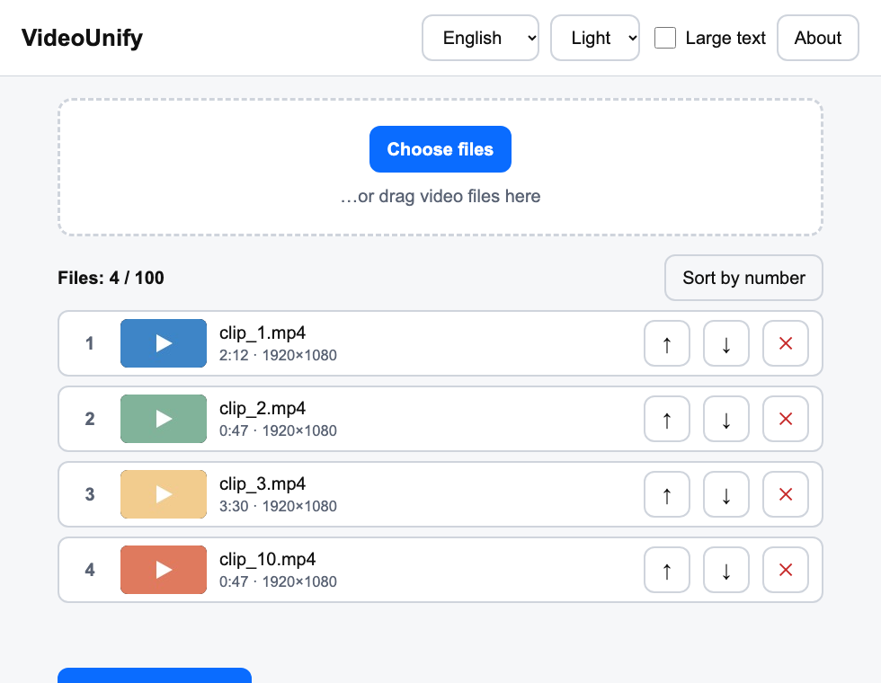
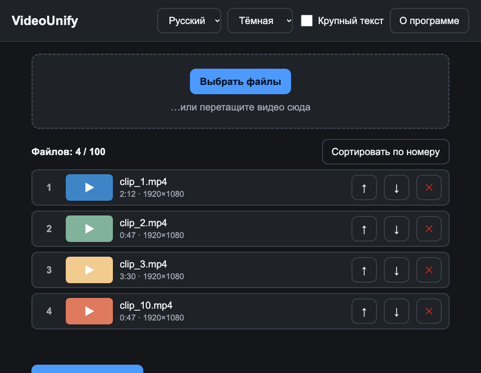
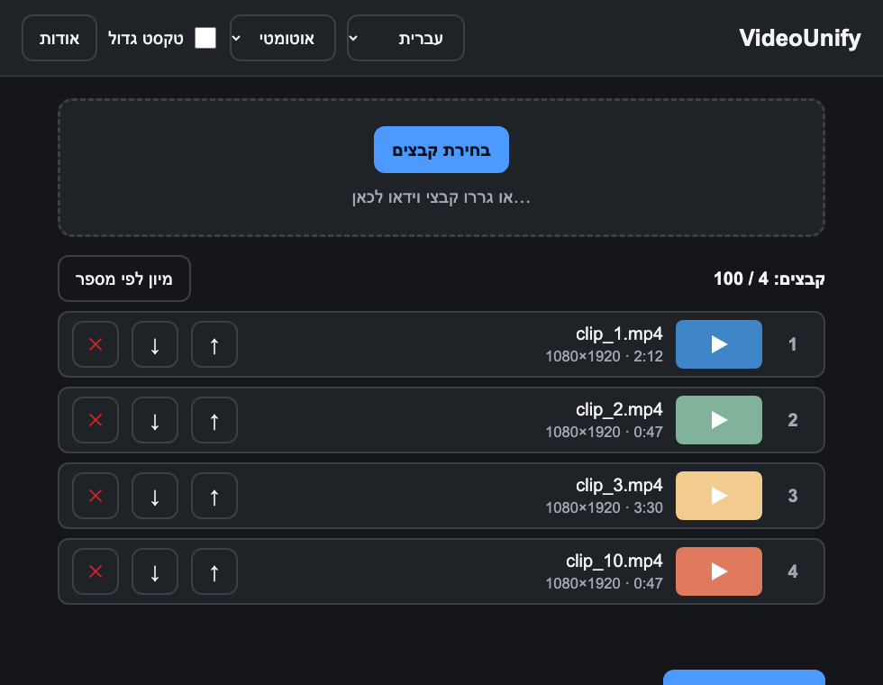
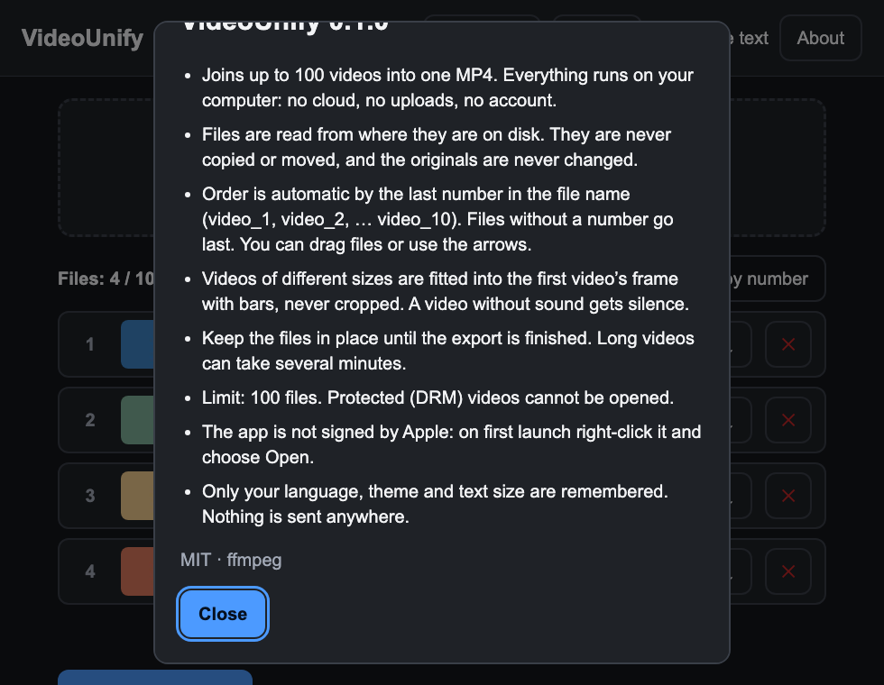

<div align="center">


# VideoUnify

**Join many videos into one MP4 — simple, private, offline.**

[](LICENSE)


English · [Русский](#русский) · [עברית](#עברית)



</div>

## Why VideoUnify

- **Dead simple** — big buttons, clear text, one task: pick videos → order → *Export to MP4*. Made to be easy for anyone, including older users.
- **Private by design** — everything runs on your computer. No cloud, no uploads, no accounts. Files are read from where they already are and never copied.
- **Smart order** — name files `holiday_1`, `holiday_2`, … `holiday_10` and they line up by number automatically.
- **Your order** — drag rows or use ↑ / ↓ buttons to change anything.
- **Any number of videos** (a warning appears after 100) — MP4, MOV, M4V, AVI, MKV; different sizes and frame rates are fitted automatically (no stretching, black bars if needed). Clips without sound are handled.
- **3 languages** — English, Русский, עברית (full right-to-left layout), light / dark / auto theme and a large-text mode.
- **Small and fast** — Rust + Tauri, ~23 MB installer with ffmpeg included.

## Screenshots

| Russian, dark theme | Hebrew (RTL) | About |
|---|---|---|
|  |  |  |

## Download

Get the latest installer from the [Releases](../../releases) page.

| System | File |
|---|---|
| macOS (Apple Silicon, 11+) | `VideoUnify-*.dmg` |
| Windows 10/11 (x64) | `VideoUnify_*-setup.exe` |

**The app is not code-signed**, so the system will warn you once:
- **macOS:** open the `.dmg`, drag the app to Applications, then **right-click → Open → Open** the first time.
- **Windows:** SmartScreen → *More info* → *Run anyway*.

## How to use

1. Click **Choose files** (or drag videos into the window).
2. Check the order; press **Sort by number** to restore automatic order.
3. Click **Export to MP4**, choose where to save.
4. Wait for the progress bar; click **Show in folder** when done.

## Output format

H.264 (x264, `veryfast`, CRF 20) + AAC 192 kb/s, 30 fps, `yuv420p`, `faststart`. The frame size of the first clip is used; other clips are letterboxed into it.

## Build from source

Requirements: Node 20+, Rust stable.

```bash
npm install
mkdir -p src-tauri/binaries
cp node_modules/ffmpeg-static/ffmpeg src-tauri/binaries/ffmpeg-$(rustc -vV | sed -n 's/host: //p')
npm run tauri dev      # run
npm run tauri build    # installer
npm test               # unit tests
```

Windows builds are produced by GitHub Actions (`.github/workflows/build.yml`).

## Privacy

No network code, no telemetry. Only your language, theme and text-size choices are stored locally.

## License

[MIT](LICENSE) · see [CHANGELOG](CHANGELOG.md)

---

## Русский

**VideoUnify** склеивает видео (после 100 файлов — предупреждение) в один MP4. Всё работает локально: без облака, без загрузок, файлы читаются из исходных папок и не копируются. Файлы с номерами в названии (`video_1`, `video_2`) выстраиваются автоматически, порядок можно менять перетаскиванием или кнопками ↑ ↓. Интерфейс на русском, иврите и английском, светлая/тёмная тема, крупный текст. Установка: скачайте файл в [Releases](../../releases); при первом запуске на Mac — правый клик → «Открыть».

## עברית

**VideoUnify** מחבר סרטונים (אזהרה אחרי 100) לקובץ MP4 אחד. הכול פועל במחשב שלך: בלי ענן ובלי העלאות. הקבצים מסודרים אוטומטית לפי המספר בשם הקובץ, ואפשר לשנות את הסדר בגרירה או בלחצני ↑ ↓. הממשק בעברית, רוסית ואנגלית, עם ערכת נושא בהירה/כהה וטקסט גדול. הורדה: [Releases](../../releases).
